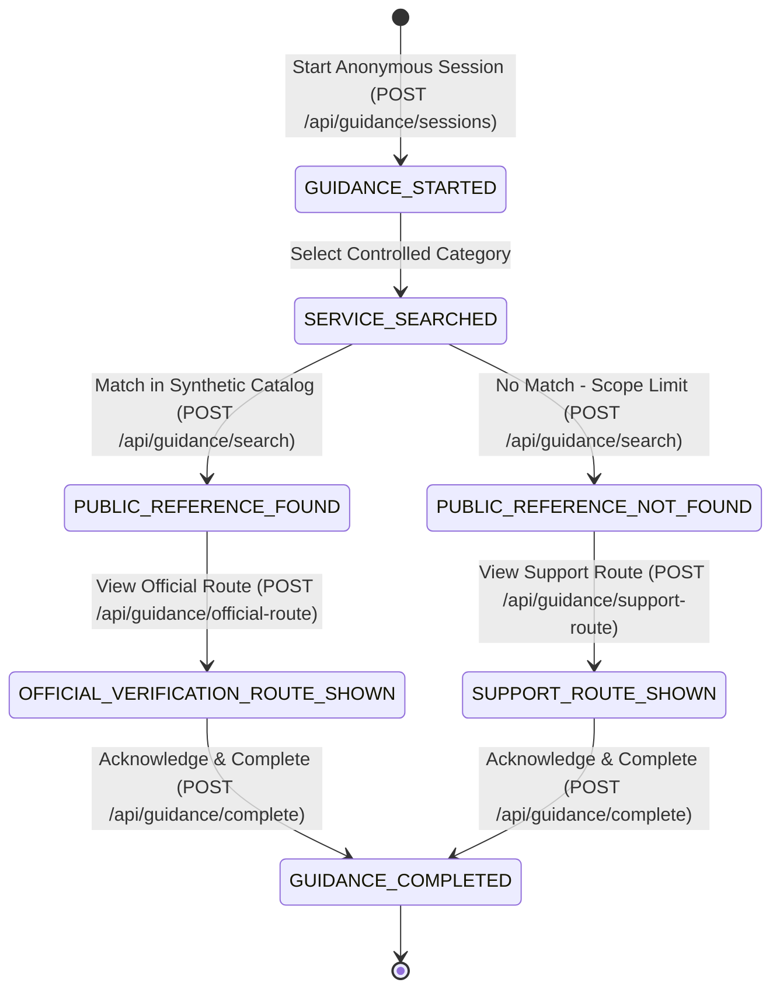

# Healthcare Access Guidance Prototype (Vertical Slice)

> **Academic Capstone Notice**: This repository contains the complete first vertical slice for a 2nd-year Application Programming (AP) and Data Engineering (DE) capstone project. It is an **educational, safe, simulated prototype** evaluating administrative public-reference guidance mechanisms.
>
> **CRITICAL SAFETY BOUNDARIES**:
> - **NOT a clinical triage or medical diagnosis system**: Zero symptom intake, clinical triage, or medical advice.
> - **NOT an official government portal, PM-JAY system, or hospital system**: Does not determine, evaluate, or guarantee scheme eligibility, coverage, cashless treatment, or claim pre-authorization.
> - **ZERO Personal Data**: No Aadhaar numbers, ABHA IDs, mobile numbers, patient names, or personal health records are stored, accepted, or logged.
> - **Student-Team-Reviewed Synthetic Demonstration Data Only**: Uses 3 neutral synthetic reference records (`DEMO-ALPHA-001`, `DEMO-BETA-002`, `DEMO-GAMMA-003`) with zero live pricing, medical procedure names, or claims of government authenticity.
> - **Controlled Dropdown Inputs Only**: All guidance inputs are restricted to allowlisted dropdown enums (`DEMO_ALPHA`, `DEMO_BETA`, `DEMO_GAMMA`, `NO_MATCH_DEMO`). Free-text query bars and file uploads are disabled by design.
> - **Generic Informational Route Card**: Displays standardized informational guidance directing users to authorized statutory channels without validating official claim portals.

---

## 1. System Architecture & Relational Schema (7 Tables)

The database schema defines 7 tables:
1. `source_document`: Tracks metadata, file integrity hash (not proof of provenance), nullable publication date/URL, and non-authoritative flag.
2. `source_import_run`: Audit log of seed/import execution runs (`STUDENT_TEAM_REVIEWED_SYNTHETIC`).
3. `package_reference`: Controlled demonstration catalogue containing fictional synthetic demo records (linked to `source_document` and `source_import_run` via foreign keys; per-record hash removed).
4. `guidance_session`: Anonymous UUID-based guidance session state machine tracker.
5. `guidance_event`: Database-enforced append-only audit event ledger (protected against UPDATE/DELETE via a PostgreSQL trigger).
6. `data_quality_issue`: Anomaly and integrity audit ledger.
7. `analytics_summary`: Rollup summary table populated by the Python Data Engineering batch aggregation script.

```
[ User Browser ]
       |  (Controlled Dropdown Only: DEMO_ALPHA, DEMO_BETA, DEMO_GAMMA, NO_MATCH_DEMO)
       v
[ React + Vite UI (apps/web) ]
       |
       |  Canonical REST API Endpoints (JSON with UUID Session Tracking)
       v
[ Express.js REST API (apps/api) ]
   ├── Per-Endpoint Strict Zod Schemas (Unknown-key rejection, no free-text)
   ├── Deterministic Guidance State Machine (Enforces strict transitions)
   └── Transactional Append-Only Event Logger
       |
       v
[ PostgreSQL Database (healthcare_guidance_db) - 7 Tables ]
   ├── source_document
   ├── source_import_run
   ├── package_reference
   ├── guidance_session
   ├── guidance_event (Append-only via trigger trg_prevent_guidance_event_mutation)
   ├── data_quality_issue
   └── analytics_summary
       ^
       | Batch Aggregate Queries (Non-PII Telemetry)
[ Python ETL Service (etl/transform_events.py) ]
```

---

## 2. Deterministic 7-State Guidance State Machine

The guidance workflow is governed by a strict, deterministic finite state machine:



Any out-of-order transition (such as attempting `GUIDANCE_STARTED` &rarr; `GUIDANCE_COMPLETED`) is strictly rejected with HTTP 409 `INVALID_STATE_TRANSITION`.

### Validation & Enforcement Separation of Concerns:
- **Database Engine (PostgreSQL)**: Validates **allowed state values** via relational `CHECK` constraints (`chk_guidance_session_state`, `chk_guidance_event_from_state`, `chk_guidance_event_to_state`, `chk_guidance_event_initial_only`) and enforces append-only immutability on `guidance_event` via trigger.
- **Application Service Layer (Express/Node.js)**: Enforces **valid state transitions** by evaluating the directed graph (`ALLOWED_TRANSITIONS`). PostgreSQL alone does not enforce dynamic state-transition pairs; this sequence logic is handled transactionally by the application service.

---

## 3. Canonical Unified API Endpoints

| Method | Endpoint | Request Payload | Response / Status |
| :--- | :--- | :--- | :--- |
| `GET` | `/api/health` | None | `{ status: "HEALTHY", service: "healthcare-guidance-api" }` (200) |
| `GET` | `/api/categories` | None | `{ total_categories: 4, categories: [...] }` (200) |
| `POST` | `/api/guidance/sessions` | `{ client_timestamp?: string }` | `{ session_id: "<UUID>", current_state: "GUIDANCE_STARTED" }` (201) |
| `POST` | `/api/guidance/search` | `{ session_id: "<UUID>", category_id: "DEMO_ALPHA" }` | `{ session, reference_found: bool, package }` (200) |
| `POST` | `/api/guidance/official-route` | `{ session_id: "<UUID>" }` | `{ session, route_info }` (200) |
| `POST` | `/api/guidance/support-route` | `{ session_id: "<UUID>" }` | `{ session, route_info }` (200) |
| `POST` | `/api/guidance/complete` | `{ session_id: "<UUID>" }` | `{ session }` (200) |
| `GET` | `/api/guidance/sessions/:id` | None (UUID in param) | `{ session, events: [...] }` (200) |
| `GET` | `/api/reference-packages` | None | `{ total_packages: 3, packages: [...] }` (200) |
| `GET` | `/api/official-support-routes` | None | Generic informational route card (200) |
| `GET` | `/api/admin/analytics/summary` | None | `{ total_sessions, completion_rate_percent, ... }` (200) |
| `GET` | `/api/admin/analytics/data-quality` | None | `{ total_issues, issues_by_severity, ... }` (200) |

> **SECURITY WARNING: `/api/admin/*` Authorization Boundary**  
> All endpoints under `/api/admin/*` are unauthenticated **ONLY** for local academic demonstration and evaluation. Before any staging or production deployment, robust role-based authorization (e.g. JWT with an explicit `ADMIN` role verification middleware) must be implemented to restrict access to operational telemetry and data quality logs.

---

## 4. Quickstart Execution Commands

```bash
# 1. Database Setup
createdb healthcare_guidance_db
psql -U postgres -d healthcare_guidance_db -f database/migrations/001_initial_schema.sql
psql -U postgres -d healthcare_guidance_db -f database/seeds/001_synthetic_seed.sql

# 2. Run API Backend
cd apps/api
npm install
npm test
npm run dev

# 3. Run Web Frontend
cd ../web
npm install
npm run dev

# 4. Run Python ETL Aggregator
cd ../../etl
python3 -m venv venv && source venv/bin/activate
pip install -r requirements.txt
python transform_events.py
```

See [setup.md](scripts/setup.md) for detailed curl verification commands.
