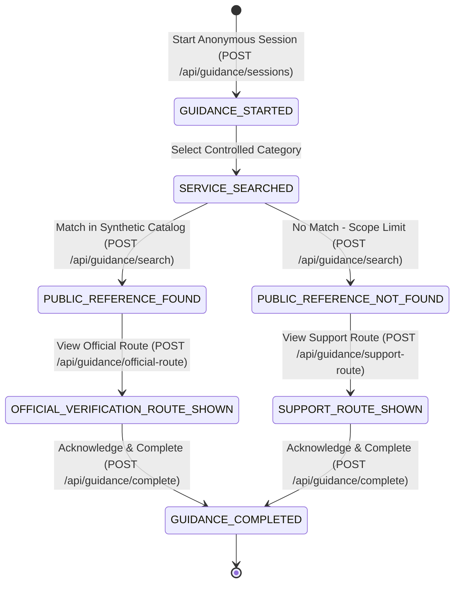

# Healthcare Access Guidance Prototype

> **Academic Capstone Notice**: This repository contains the complete codebase for a 2nd-year Application Programming (AP) and Data Engineering (DE) capstone project. It is an **educational, safe, simulated prototype** evaluating administrative public-reference guidance mechanisms.
>
> **CRITICAL SAFETY BOUNDARIES**:
> - **NOT a clinical triage or medical diagnosis system**: Zero symptom intake, clinical triage, or medical advice.
> - **NOT an official government portal, PM-JAY system, or hospital system**: Does not determine, evaluate, or guarantee scheme eligibility, coverage, cashless treatment, or claim pre-authorization.
> - **ZERO Personal Data**: No Aadhaar numbers, ABHA IDs, mobile numbers, patient names, or personal health records are stored, accepted, or logged.
> - **Student-Team-Reviewed Synthetic Demonstration Data Only**: Uses neutral synthetic reference records (`DEMO-ALPHA-001`, `DEMO-BETA-002`, `DEMO-GAMMA-003`) with zero live pricing, medical procedure names, or claims of government authenticity.
> - **Controlled Dropdown Inputs Only**: All guidance inputs are restricted to allowlisted dropdown enums (`DEMO_ALPHA`, `DEMO_BETA`, `DEMO_GAMMA`, `NO_MATCH_DEMO`). Free-text query bars and file uploads are disabled by design.
> - **Generic Informational Route Card**: Displays standardized informational guidance directing users to authorized statutory channels without validating official claim portals.

---

## Project Status & Milestones

- **Phase 1 Complete**: Tagged as `v0.1-synthetic-vertical-slice`. Built the initial synthetic vertical slice, PostgreSQL 7-table schema, deterministic 7-state guidance state machine, append-only trigger immutability, Python ETL aggregator, and baseline test suite.
- **Phase 2 Complete**: Tagged as `v0.2-phase-2-validation`. Validated end-to-end workflows, implemented the admin authorization boundary (`requireAdmin`), established the usability and comprehension testing framework ([usability_test_plan.md](file:///Users/ishikajain/healthcare-access-guidance-capstone/docs/usability_test_plan.md)), codified the 13-point source-verification gate ([source_verification_gate.md](file:///Users/ishikajain/healthcare-access-guidance-capstone/docs/source_verification_gate.md)), and expanded backend tests to 23/23 passing.

---

## 1. System Architecture & Relational Schema (7 Tables)

The database schema defines 7 tables:
1. `source_document`: Tracks metadata, file integrity hash (not proof of provenance), nullable publication date/URL, and non-authoritative flag.
2. `source_import_run`: Audit log of seed/import execution runs (`STUDENT_TEAM_REVIEWED_SYNTHETIC`).
3. `package_reference`: Controlled demonstration catalogue containing fictional synthetic demo records (linked to `source_document` and `source_import_run` via foreign keys).
4. `guidance_session`: Anonymous UUID-based guidance session state machine tracker.
5. `guidance_event`: Database-enforced append-only audit event ledger (protected against UPDATE/DELETE via a PostgreSQL trigger).
6. `data_quality_issue`: Anomaly and integrity audit ledger.
7. `analytics_summary`: Rollup summary table populated by the Python Data Engineering batch aggregation script.

```
[ User Browser ]
       |  (Controlled Dropdown Only: DEMO_ALPHA, DEMO_BETA, DEMO_GAMMA, NO_MATCH_DEMO)
       v
[ React + Vite UI (apps/web) ]
       |
       |  Canonical REST API Endpoints (JSON with UUID Session Tracking)
       v
[ Express.js REST API (apps/api - Port 5001) ]
   ├── requireAdmin Authorization Boundary (/api/admin/*)
   ├── Per-Endpoint Strict Zod Schemas (Unknown-key rejection, no free-text)
   ├── Deterministic Guidance State Machine (Enforces strict transitions)
   └── Transactional Append-Only Event Logger
       |
       v
[ PostgreSQL Database (healthcare_guidance_db) - 7 Tables ]
   ├── source_document
   ├── source_import_run
   ├── package_reference
   ├── guidance_session
   ├── guidance_event (Append-only via trigger trg_prevent_guidance_event_mutation)
   ├── data_quality_issue
   └── analytics_summary
       ^
       | Batch Aggregate Queries (Non-PII Telemetry)
[ Python ETL Service (etl/transform_events.py) ]
```

---

## 2. Deterministic 7-State Guidance State Machine

The guidance workflow is governed by a strict, deterministic finite state machine:



Any out-of-order transition (such as attempting `GUIDANCE_STARTED` &rarr; `GUIDANCE_COMPLETED`) is strictly rejected with HTTP 409 `INVALID_STATE_TRANSITION`.

---

## 3. Canonical Unified API Endpoints

| Method | Endpoint | Authorization | Request Payload | Response / Status |
| :--- | :--- | :--- | :--- | :--- |
| `GET` | `/api/health` | Public | None | `{ status: "HEALTHY", service: "healthcare-guidance-api" }` (200) |
| `GET` | `/api/categories` | Public | None | `{ total_categories: 4, categories: [...] }` (200) |
| `POST` | `/api/guidance/sessions` | Public | `{ client_timestamp?: string }` | `{ session_id: "<UUID>", current_state: "GUIDANCE_STARTED" }` (201) |
| `POST` | `/api/guidance/search` | Public | `{ session_id: "<UUID>", category_id: "DEMO_ALPHA" }` | `{ session, reference_found: bool, package }` (200) |
| `POST` | `/api/guidance/official-route`| Public | `{ session_id: "<UUID>" }` | `{ session, route_info }` (200) |
| `POST` | `/api/guidance/support-route` | Public | `{ session_id: "<UUID>" }` | `{ session, route_info }` (200) |
| `POST` | `/api/guidance/complete` | Public | `{ session_id: "<UUID>" }` | `{ session }` (200) |
| `GET` | `/api/guidance/sessions/:id` | Public | None (UUID in param) | `{ session, events: [...] }` (200) |
| `GET` | `/api/reference-packages` | Public | None | `{ total_packages: 3, packages: [...] }` (200) |
| `GET` | `/api/official-support-routes`| Public | None | Generic informational route card (200) |
| `GET` | `/api/admin/analytics/summary`| **requireAdmin** | Header: `Authorization: Bearer <token>` | Telemetry summary (200 / 401 / 403) |
| `GET` | `/api/admin/analytics/data-quality`| **requireAdmin** | Header: `Authorization: Bearer <token>` | Data quality audit ledger (200 / 401 / 403) |

---

## 4. Admin Route Authorization Boundary (`requireAdmin`)

> **SECURITY WARNING: PROHIBITION OF LOCAL DEMO BYPASS IN PRODUCTION**  
> All endpoints under `/api/admin/*` are protected by the `requireAdmin` middleware.  
> The environment variable `ALLOW_UNAUTHENTICATED_ADMIN_DEMO=true` enables an unauthenticated bypass **SOLELY** for local developer evaluation and single-machine academic demos.  
> **THIS BYPASS MUST NEVER BE ENABLED IN STAGING, PRODUCTION, OR ANY ENVIRONMENT EXPOSING SENSITIVE TELEMETRY.**  
> When the bypass is disabled:
> - Unauthenticated requests receive **HTTP 401 UNAUTHORIZED**.
> - Authenticated non-admin requests receive **HTTP 403 FORBIDDEN**.
> - Requests bearing an admin token (`Bearer demo-admin-token`) receive **HTTP 200 OK**.

---

## 5. Quickstart Execution Commands

### Prerequisites
- Node.js v18+
- PostgreSQL 14+
- Python 3.9+ with `venv`

### Step 1: Database Setup
```bash
createdb healthcare_guidance_db
psql -U postgres -d healthcare_guidance_db -f database/migrations/001_initial_schema.sql
psql -U postgres -d healthcare_guidance_db -f database/migrations/002_verification_hardening.sql
psql -U postgres -d healthcare_guidance_db -f database/seeds/001_synthetic_seed.sql
```

### Step 2: Run Backend API & Tests
```bash
cd apps/api
cp .env.example .env # Ensure PORT=5001 and ALLOW_UNAUTHENTICATED_ADMIN_DEMO=true
npm install
npm test             # Runs 23/23 integration tests
node src/server.js   # Starts backend on http://localhost:5001
```

### Step 3: Run Web Frontend
```bash
cd apps/web
npm install
npm run build        # Verifies bundle compilation (zero router/lucide dependencies)
npm run dev          # Starts Vite on http://localhost:5173 (proxies /api to 5001)
```

### Step 4: Run Python ETL Batch Aggregator
```bash
cd etl
python3 -m venv venv && source venv/bin/activate
pip install -r requirements.txt
python transform_events.py
```

### Step 5: Review Usability & Source Verification Documentation
- **Usability Test Protocol**: [docs/usability_test_plan.md](file:///Users/ishikajain/healthcare-access-guidance-capstone/docs/usability_test_plan.md)
- **Usability Findings Ledger**: [docs/usability_findings.md](file:///Users/ishikajain/healthcare-access-guidance-capstone/docs/usability_findings.md)
- **Source Verification Gate**: [docs/source_verification_gate.md](file:///Users/ishikajain/healthcare-access-guidance-capstone/docs/source_verification_gate.md)
- **Safety Boundary Specification**: [docs/safety_boundary.md](file:///Users/ishikajain/healthcare-access-guidance-capstone/docs/safety_boundary.md)
- **Audit Verification Log**: [docs/verification_log.md](file:///Users/ishikajain/healthcare-access-guidance-capstone/docs/verification_log.md)
- **Project Status & Roadmap**: [docs/project_status.md](file:///Users/ishikajain/healthcare-access-guidance-capstone/docs/project_status.md)
