# Data Flow Diagram — Level 0 (System Context Diagram)

> **Document Path**: `docs/architecture/dfd-level-0.md`  
> **Status**: Architecture Freeze v2.1  
> **System**: Healthcare Access Guidance & Operations Platform

---

## 1. System Context Overview

The **Level 0 Data Flow Diagram (DFD)** defines the highest-level operational context of the **Healthcare Access Guidance & Operations Platform**. It establishes the functional boundary of the system, identifying all external entities (both human actors and automated processes), the inbound data flows they supply, and the outbound informational flows they receive.

### External Entities

1. **Citizen / Public User**: Anonymous individuals seeking administrative guidance regarding statutory healthcare access pathways. Interacts strictly through allowlisted category dropdowns without providing personal identifiers.
2. **Hospital Staff / Desk Operator**: Operational personnel managing consultation counters, calling and servicing Outpatient Department (OPD) queue tokens, updating inpatient bed statuses, coordinating ward admissions, and logging dispensary stock movements.
3. **System Administrator / Compliance Auditor**: Privileged technical evaluators and compliance monitors reviewing aggregate telemetry, monitoring data quality flags, and auditing system event ledgers. Access is protected by the `requireAdmin` authorization boundary.
4. **Offline Batch ETL Engine**: Scheduled Python background workers (`transform_events.py`, `aggregate_city_snapshot.py`) executing batch extractions and returning calculated analytical summaries and multi-tier municipal snapshots.

### External Exclusions (Strict Non-Integration Boundary)

- **Live Government Scheme Portals (e.g., Ayushman Bharat / PM-JAY)**: The platform does **not** communicate with live government servers, scheme eligibility APIs, or claim pre-authorization portals. All catalogue items are synthetic demonstration records (`DEMO-ALPHA-001`).
- **Live Hospital Electronic Health Record (EHR / HIS) Systems**: The platform does **not** integrate with live hospital electronic health record systems or HL7/FHIR feeds. Operational records reflect synthetic facility workflows.

---

## 2. Level 0 System Context Diagram

```mermaid
flowchart TD
    %% External Entities
    subgraph EXT_USERS["External Human Actors"]
        CITIZEN["Citizen / Public User<br/>(Anonymous Public Actor)"]
        STAFF["Hospital Staff / Desk Operator<br/>(Facility Operational Personnel)"]
        ADMIN["System Administrator / Auditor<br/>(Privileged Compliance Actor)"]
    end

    subgraph EXT_AUTOMATION["Automated Background Subsystems"]
        ETL["Offline Batch ETL Engine<br/>(Python Data Engineering Runners)"]
    end

    %% Central Platform System
    PLATFORM(["Healthcare Access Guidance & Operations Platform<br/>(Unified Express REST API & PostgreSQL Storage)"]):::platformClass

    %% External Systems (Explicit Out-of-Scope Isolation)
    subgraph OUT_OF_SCOPE["Explicit Non-Integration Boundary (Out of Scope)"]
        GOV_SCHEME["Live Government Portals / PM-JAY APIs<br/>(NO CONNECTION — Synthetic Catalog Only)"]:::excludedClass
        HOSP_HIS["Live Hospital EHR / HIS Networks<br/>(NO CONNECTION — Simulated Facilities Only)"]:::excludedClass
    end

    %% Inbound / Outbound Data Flows: Citizen
    CITIZEN -->|"1. Session Init Request & Allowlisted Category Selection"| PLATFORM
    PLATFORM -->|"2. Ephemeral Session UUID, Synthetic Match, Generic Route Card"| CITIZEN

    %% Inbound / Outbound Data Flows: Staff Operator
    STAFF -->|"3. Queue Actions (Issue Token, Call, Start, Complete)"| PLATFORM
    STAFF -->|"4. Bed Transitions (Reserve, Occupy, Clean, Release)"| PLATFORM
    STAFF -->|"5. Inpatient Lifecycle & Bed Allocations"| PLATFORM
    STAFF -->|"6. Dispensary Stock Receipts, Issues & Adjustments"| PLATFORM
    PLATFORM -->|"7. Live Queue Telemetry, Bed Matrix, Stock & Low-Stock Alerts"| STAFF

    %% Inbound / Outbound Data Flows: Administrator
    ADMIN -->|"8. Admin Analytics Query (Bearer Token Authenticated)"| PLATFORM
    PLATFORM -->|"9. Non-PII Rollup Summaries & Data Quality Issue Ledgers"| ADMIN

    %% Inbound / Outbound Data Flows: Offline Batch ETL
    ETL -->|"10. Batch Data Extraction Query (Sessions, Events, Ops Tables)"| PLATFORM
    PLATFORM -->|"11. Raw Operational Datasets & Append-Only Logs"| ETL
    ETL -->|"12. Computed Daily Telemetry & Hierarchical City Snapshots"| PLATFORM

    %% Disconnected Indicators
    PLATFORM -.-x|"Zero Live Integration"| GOV_SCHEME
    PLATFORM -.-x|"Zero Live Integration"| HOSP_HIS

    classDef platformClass fill:#1e293b,stroke:#3b82f6,stroke-width:3px,color:#ffffff;
    classDef excludedClass fill:#f1f5f9,stroke:#94a3b8,stroke-dasharray: 5 5,color:#64748b;
```



---

## 3. Data Flow Inventory & Boundary Definitions

The following table details the authoritative data flows crossing the system boundary in the Level 0 Context Diagram:

| Flow # | Source Entity | Target Entity | Data Flow Name | Payload Content & Description | Protocol / Security Boundary |
| :--- | :--- | :--- | :--- | :--- | :--- |
| **1** | Citizen / Public User | Platform | **Guidance Request** | Ephemeral timestamp, allowlisted category enum (`DEMO_ALPHA`, `DEMO_BETA`, `DEMO_GAMMA`, `NO_MATCH_DEMO`). Zero PII. | HTTP POST, Public REST API, Strict Zod validation |
| **2** | Platform | Citizen / Public User | **Guidance Output** | Anonymous session UUID, matched synthetic package (`DEMO-ALPHA-001`), generic statutory route card, disclaimers. | HTTP JSON Response (200 / 201) |
| **3** | Staff Operator | Platform | **OPD Queue Dispatch** | Hospital ID, Department ID, Counter ID, Priority level, Token transition triggers (`call`, `start`, `complete`, `cancel`). | HTTP POST, Operations Console, Parameterized SQL |
| **4** | Staff Operator | Platform | **Bed State Action** | Bed ID, target state transition (`reserve`, `occupy`, `clean`, `release`, `out-of-service`, `restore`). | HTTP POST, Trigger Validation (`trg_validate_bed_state_transition`) |
| **5** | Staff Operator | Platform | **Inpatient Coordination** | Hospital ID, Ward ID, Target Bed ID, Admission status transition, operational notes. | HTTP POST, Trigger Validation (`trg_validate_admission_bed_hierarchy`) |
| **6** | Staff Operator | Platform | **Dispensary Stock Log** | Hospital ID, Item ID, Transaction type (`RECEIPT`, `ISSUE`), Quantity, Batch number, optional linked token UUID. | HTTP POST, Append-Only Trigger (`trg_prevent_inventory_transaction_mutation`) |
| **7** | Platform | Staff Operator | **Operational Console Feed** | Real-time queue counters, M/M/c analytical benchmarks, ward bed occupancy matrix, low-stock threshold alerts. | HTTP GET, JSON Responses |
| **8** | Administrator | Platform | **Admin Telemetry Query** | Admin Authorization header (`Bearer <admin-token>`), date filters. | HTTP GET, `requireAdmin` Authorization Middleware |
| **9** | Platform | Administrator | **Audit & Metric Telemetry** | Aggregate session counts, completion rates, transition distributions, data quality anomaly records. | HTTP JSON Response (200 / 401 / 403) |
| **10** | Offline Batch ETL | Platform | **Batch Extract Query** | SQL SELECT queries targeting `guidance_event`, `guidance_session`, `opd_token`, `bed`, `admission`, `inventory_item`. | PostgreSQL TCP Connection, `psycopg2` Client |
| **11** | Platform | Offline Batch ETL | **Operational Extract** | Raw tabular records extracted into Python pandas DataFrames for vector aggregation. | PostgreSQL RealDictCursor Stream |
| **12** | Offline Batch ETL | Platform | **Snapshot Upsert** | SQL INSERT ... ON CONFLICT DO UPDATE batch statements into `analytics_summary` and `city_aggregate_snapshot`. | PostgreSQL Parameterized Batch Executions |

---

## 4. Trust Boundaries & Security Classifications

The Level 0 Context Diagram establishes three distinct security zones:

```
[ ZONE 1: PUBLIC ANONYMOUS ]
  - Citizen Guidance endpoints (/api/guidance/*, /api/categories, /api/reference-packages)
  - Zero authentication required; strictly no PII accepted; unknown payload keys rejected.
  |
[ ZONE 2: INTERNAL OPERATIONS CONSOLE ]
  - Facility operational endpoints (/api/hospitals/*, /api/opd/*, /api/beds/*, /api/admissions/*, /api/inventory/*)
  - Manages internal hospital workflows; validated via composite keys and PL/pgSQL triggers.
  |
[ ZONE 3: PRIVILEGED ADMINISTRATIVE AUDIT ]
  - Protected endpoints (/api/admin/analytics/*)
  - Enforced by requireAdmin middleware; Bearer token required in production environments.
```
