# Data Flow Diagram — Level 1 (Subsystem Process Decomposition)

> **Document Path**: `docs/architecture/dfd-level-1.md`  
> **Status**: Architecture Freeze v2.1  
> **System**: Healthcare Access Guidance & Operations Platform

---

## 1. Subsystem Decomposition Overview

The **Level 1 Data Flow Diagram (DFD)** decomposes the central platform into **six primary functional processes (P1–P6)** and maps their data interactions across the **17 authoritative database stores (D1–D17)**.

### Process Inventory

| Process ID | Process Name | Module Path | Functional Responsibility |
| :--- | :--- | :--- | :--- |
| **P1** | **Anonymous Citizen Guidance Engine** | `apps/api/src/controllers/guidanceSessionController.js` `apps/api/src/services/guidanceSessionService.js` | Manages anonymous citizen sessions, processes controlled category searches, queries synthetic catalog, enforces 7-state guidance machine, records append-only events. |
| **P2** | **OPD Queue Dispatcher & Flow Controller** | `apps/api/src/controllers/opdTokenController.js` `apps/api/src/services/opdTokenService.js` `apps/api/src/utils/mmc.js` | Issues queue tokens, dispatches tokens to counters, tracks waiting/serving timestamps, and calculates Kendall M/M/c analytical benchmarks. |
| **P3** | **Inpatient Bed & Admission Coordinator** | `apps/api/src/controllers/bedController.js` `apps/api/src/controllers/admissionController.js` `apps/api/src/services/bedService.js` | Manages ward capacities, enforces bed state transitions via trigger, assigns beds to admissions, and verifies facility-ward-bed hierarchy. |
| **P4** | **Dispensary Inventory Ledger Manager** | `apps/api/src/controllers/inventoryController.js` `apps/api/src/services/inventoryService.js` | Tracks synthetic medicine/consumable stock levels, emits low-stock alerts, and logs stock movements into an immutable append-only ledger. |
| **P5** | **Administrative Telemetry & Audit Service** | `apps/api/src/controllers/adminAnalyticsController.js` `apps/api/src/services/adminAnalyticsService.js` | Enforces `requireAdmin` boundary, queries aggregated session telemetry, and exposes the data quality audit ledger. |
| **P6** | **Periodic Offline Batch ETL Engine** | `etl/transform_events.py` `etl/aggregate_city_snapshot.py` | Extracts operational logs, calculates daily session completion metrics, computes hierarchical municipal rollups, and performs idempotent upserts. |

### Complete 17-Data Store Mapping

- `D1`: Source Document Registry (`source_document`)
- `D2`: Source Import Execution Log (`source_import_run`)
- `D3`: Package Reference Catalog (`package_reference`)
- `D4`: Guidance Session Store (`guidance_session`)
- `D5`: Guidance Event Ledger — *Append-Only Trigger* (`guidance_event`)
- `D6`: Data Quality Issue Ledger (`data_quality_issue`)
- `D7`: Analytics Summary Rollup Store (`analytics_summary`)
- `D8`: Hospital Facility Registry (`hospital`)
- `D9`: Department Registry (`department`)
- `D10`: OPD Queue Counter Store (`opd_queue_counter`)
- `D11`: OPD Queue Token Store (`opd_token`)
- `D12`: Bed Ward Store (`bed_ward`)
- `D13`: Bed Store — *State Transition Trigger* (`bed`)
- `D14`: Inpatient Admission Store — *Hierarchy Trigger* (`admission`)
- `D15`: Dispensary Inventory Store (`inventory_item`)
- `D16`: Inventory Transaction Ledger — *Append-Only Trigger* (`inventory_transaction`)
- `D17`: City Aggregate Snapshot Store (`city_aggregate_snapshot`)

---

## 2. Level 1 Data Flow Diagram

```mermaid
flowchart TD
    %% External Entities
    subgraph ENTITIES["External Actors & Runners"]
        CITIZEN["Citizen / Public User"]:::actorClass
        STAFF["Hospital Staff Operator"]:::actorClass
        ADMIN["System Administrator / Auditor"]:::actorClass
        ETL_CRON["Scheduled ETL Runner"]:::actorClass
    end

    %% Processes
    subgraph PROCESSES["Platform Core Processes"]
        P1["P1: Anonymous Citizen Guidance Engine"]:::processClass
        P2["P2: OPD Queue Dispatcher & Flow Controller"]:::processClass
        P3["P3: Inpatient Bed & Admission Coordinator"]:::processClass
        P4["P4: Dispensary Inventory Ledger Manager"]:::processClass
        P5["P5: Administrative Telemetry & Audit Service"]:::processClass
        P6["P6: Periodic Offline Batch ETL Engine"]:::processClass
    end

    %% Data Stores: Domain 1 (Guidance)
    subgraph STORES_GUIDANCE["Guidance Data Stores"]
        D1[("D1: source_document")]:::storeClass
        D2[("D2: source_import_run")]:::storeClass
        D3[("D3: package_reference")]:::storeClass
        D4[("D4: guidance_session")]:::storeClass
        D5[("D5: guidance_event<br/>(Append-Only Trigger)")]:::storeTriggerClass
        D6[("D6: data_quality_issue")]:::storeClass
        D7[("D7: analytics_summary")]:::storeClass
    end

    %% Data Stores: Domain 2 (Operations)
    subgraph STORES_OPS["Hospital Operations Data Stores"]
        D8[("D8: hospital")]:::storeClass
        D9[("D9: department")]:::storeClass
        D10[("D10: opd_queue_counter")]:::storeClass
        D11[("D11: opd_token")]:::storeClass
        D12[("D12: bed_ward")]:::storeClass
        D13[("D13: bed<br/>(State Transition Trigger)")]:::storeTriggerClass
        D14[("D14: admission<br/>(Hierarchy Trigger)")]:::storeTriggerClass
        D15[("D15: inventory_item")]:::storeClass
        D16[("D16: inventory_transaction<br/>(Append-Only Trigger)")]:::storeTriggerClass
    end

    %% Data Stores: Domain 3 (City Snapshots)
    subgraph STORES_TELEMETRY["City Telemetry Data Stores"]
        D17[("D17: city_aggregate_snapshot")]:::storeClass
    end

    %% P1 Guidance Flows
    CITIZEN -->|"Start session / Select category"| P1
    P1 -->|"Guidance route card & session ID"| CITIZEN
    P1 -->|"Query catalog"| D3
    D3 -.->|"Package details"| P1
    P1 -->|"Create / Update session state"| D4
    D4 -.->|"Current state"| P1
    P1 -->|"Append state event (INSERT only)"| D5
    P1 -.->|"Verify source integrity"| D1

    %% P2 OPD Flows
    STAFF -->|"Issue token / Call / Start / Complete"| P2
    P2 -->|"Live queue state & M/M/c wait metrics"| STAFF
    P2 -->|"Read facility/dept/counters"| D8
    P2 -->|"Read facility/dept/counters"| D9
    P2 -->|"Read/update counter state"| D10
    P2 -->|"Insert & update token lifecycle"| D11
    D11 -.->|"Active queue records"| P2
    P1 -.->|"Optional session link"| D11

    %% P3 Bed & Admission Flows
    STAFF -->|"Transition bed state / Admit patient"| P3
    P3 -->|"Ward bed matrix & admission roster"| STAFF
    P3 -->|"Read ward capacities"| D12
    P3 -->|"Update bed state (trigger-checked)"| D13
    D13 -.->|"Current bed status"| P3
    P3 -->|"Create & update admission record"| D14
    D14 -.->|"Admission status"| P3
    D11 -.->|"Optional OPD token escalation"| P3

    %% P4 Inventory Flows
    STAFF -->|"Receive / Issue / Adjust stock"| P4
    P4 -->|"Stock levels & low-stock alerts"| STAFF
    P4 -->|"Read & update current stock"| D15
    D15 -.->|"Item catalog & reorder thresholds"| P4
    P4 -->|"Append stock transaction (INSERT only)"| D16
    D11 -.->|"Optional token link for dispense"| P4

    %% P5 Admin Telemetry Flows
    ADMIN -->|"Request telemetry (Bearer Token)"| P5
    P5 -->|"Aggregated KPIs & DQ audit reports"| ADMIN
    P5 -->|"Query session rollups"| D7
    P5 -->|"Query audit issues"| D6

    %% P6 Offline Batch ETL Flows
    ETL_CRON -->|"Trigger scheduled batch execution"| P6
    P6 -->|"Extract session & event history"| D4
    P6 -->|"Extract session & event history"| D5
    P6 -->|"Extract facility operational metrics"| D8
    P6 -->|"Extract facility operational metrics"| D9
    P6 -->|"Extract queue metrics"| D11
    P6 -->|"Extract bed status metrics"| D13
    P6 -->|"Extract admission metrics"| D14
    P6 -->|"Extract inventory metrics"| D15
    P6 -->|"Upsert non-PII session metrics"| D7
    P6 -->|"Idempotent upsert city aggregate snapshots"| D17
    P6 -->|"Log detected data anomalies"| D6

    classDef actorClass fill:#0f172a,stroke:#38bdf8,stroke-width:2px,color:#ffffff;
    classDef processClass fill:#1e293b,stroke:#818cf8,stroke-width:2px,color:#ffffff;
    classDef storeClass fill:#1e1b4b,stroke:#a78bfa,stroke-width:2px,color:#ffffff;
    classDef storeTriggerClass fill:#311042,stroke:#f43f5e,stroke-width:2px,color:#ffffff;
```

---

## 3. Detailed Process Specifications & Data Interchanges

### 3.1 Process 1.0 (P1): Anonymous Citizen Guidance Engine
- **Inbound Data Flows**:
  - `POST /api/guidance/sessions`: Ephemeral client timestamp; initiates session state machine at `GUIDANCE_STARTED`.
  - `POST /api/guidance/search`: Requires valid `session_id` UUID and allowlisted `category_id` (`DEMO_ALPHA`, `DEMO_BETA`, `DEMO_GAMMA`, `NO_MATCH_DEMO`).
  - `POST /api/guidance/official-route` or `/api/guidance/support-route`: Progresses session to route display state.
  - `POST /api/guidance/complete`: Transitions session to terminal `GUIDANCE_COMPLETED` state.
- **Data Store Interactions**:
  - Writes to `D4 (guidance_session)`: Updates `current_state`, `is_completed`, `selected_category`, `reference_found`, `matched_package_id`.
  - Reads from `D3 (package_reference)`: Retrieves synthetic package details (`DEMO-ALPHA-001`, `simulation_notice`, `official_verification_channel`).
  - Writes to `D5 (guidance_event)`: Appends immutable audit record with `event_type`, `from_state`, `to_state`, and JSON payload.
- **Trigger Defenses**:
  - `D5` is guarded by PL/pgSQL trigger `trg_prevent_guidance_event_mutation`. Any attempt by application bugs or malicious queries to `UPDATE` or `DELETE` events fails with an immediate database exception.

---

### 3.2 Process 2.0 (P2): OPD Queue Dispatcher & Flow Controller
- **Inbound Data Flows**:
  - `POST /api/opd/tokens`: Allocates next sequential queue token for a hospital department (`WAITING`).
  - `POST /api/opd/tokens/:id/call`: Assigns token to active counter (`CALLED`), records `called_at`.
  - `POST /api/opd/tokens/:id/start`: Transitions to `IN_SERVICE`, records `service_started_at`.
  - `POST /api/opd/tokens/:id/complete`: Transitions to `COMPLETED`, records `service_completed_at`.
  - `POST /api/opd/tokens/:id/cancel`: Transitions to `CANCELLED`, records `cancelled_at`.
  - `GET /api/opd/analytics`: Queries queue statistics and calculates Kendall M/M/c analytical benchmarks.
- **Data Store Interactions**:
  - Reads from `D8 (hospital)`, `D9 (department)`, `D10 (opd_queue_counter)`.
  - Reads and writes to `D11 (opd_token)`. Enforces CHECK constraints ensuring `counter_id` is assigned when active and timestamps are chronologically ordered.
- **Analytical Benchmark Computation**:
  - Process executes `calculateMmc({ lambda, mu, c })` via `apps/api/src/utils/mmc.js`. Evaluates arrival rate ($\lambda$), service rate ($\mu$), and active counters ($c$), producing theoretical server utilization ($\rho$), probability of queueing ($P_{wait}$), expected queue length ($L_q$), and expected waiting time ($W_q$).

---

### 3.3 Process 3.0 (P3): Inpatient Bed & Admission Coordinator
- **Inbound Data Flows**:
  - `POST /api/beds/:id/{reserve|occupy|clean|release|out-of-service|restore}`: Operational bed state transition triggers.
  - `POST /api/admissions`: Initiates inpatient admission request (`ADMISSION_REQUESTED`).
  - `POST /api/admissions/:id/assign-bed`: Binds specific `bed_id` to admission record (`BED_ASSIGNED`).
  - `POST /api/admissions/:id/{confirm|admit|discharge|cancel}`: Inpatient lifecycle status transitions.
- **Data Store Interactions**:
  - Reads from `D12 (bed_ward)`: Confirms ward capacity and ward types (`GENERAL`, `ICU`, `HDU`, `EMERGENCY`).
  - Reads and writes to `D13 (bed)`: Updates `current_state` and `last_status_change_at`.
  - Reads and writes to `D14 (admission)`: Updates admission lifecycle status and timestamps.
- **Trigger Defenses**:
  - `D13` is protected by `trg_validate_bed_state_transition`: strictly rejects illegal bed state transitions (e.g., jumping from `OCCUPIED` directly to `AVAILABLE` without passing through `CLEANING`).
  - `D14` is protected by `trg_validate_admission_bed_hierarchy`: asserts that the assigned `bed_id` belongs to the exact `hospital_id` and `ward_id` specified in the admission record.

---

### 3.4 Process 4.0 (P4): Dispensary Inventory Ledger Manager
- **Inbound Data Flows**:
  - `POST /api/inventory/items/:id/receive`: Stock addition (`RECEIPT`), increments `current_stock`.
  - `POST /api/inventory/items/:id/issue`: Stock deduction (`ISSUE`), decrements `current_stock`.
  - `POST /api/inventory/items/:id/adjust`: Stock reconciliation (`ADJUSTMENT`).
  - `POST /api/inventory/items/:id/{transfer-in|transfer-out}`: Inter-departmental stock transfers.
  - `GET /api/inventory/availability`: Low-stock alert query.
- **Data Store Interactions**:
  - Reads and updates `D15 (inventory_item)`: Updates `current_stock`.
  - Writes to `D16 (inventory_transaction)`: Inserts immutable transaction record with quantity, batch number, and audit reason.
- **Trigger Defenses**:
  - `D16` is guarded by `trg_prevent_inventory_transaction_mutation`: enforces strictly immutable append-only ledger semantics.

---

### 3.5 Process 5.0 (P5): Administrative Telemetry & Audit Service
- **Inbound Data Flows**:
  - `GET /api/admin/analytics/summary`: Requests platform-wide non-PII operational KPIs.
  - `GET /api/admin/analytics/data-quality`: Requests anomaly and data quality ledger.
- **Authorization Boundary**:
  - Evaluated by `requireAdmin` middleware. If `ALLOW_UNAUTHENTICATED_ADMIN_DEMO` is not `true`, requests without a valid `Bearer demo-admin-token` are rejected with HTTP 401/403.
- **Data Store Interactions**:
  - Reads from `D7 (analytics_summary)`: Retrieves precomputed session totals, completion rates, and event distributions.
  - Reads from `D6 (data_quality_issue)`: Retrieves detected schema anomalies, validation flags, and resolution statuses.

---

### 3.6 Process 6.0 (P6): Periodic Offline Batch ETL Engine
- **Inbound Trigger**:
  - Scheduled automated runner or manual administrative command invoking `transform_events.py` or `aggregate_city_snapshot.py`.
- **Extraction Phase**:
  - Queries `D4`, `D5`, `D8`, `D9`, `D10`, `D11`, `D12`, `D13`, `D14`, `D15`.
- **Transformation Phase**:
  - Groups sessions and events by date to calculate conversion funnels.
  - Computes 3-tier hierarchical operational summaries:
    1. **DEPARTMENT Level**: Token volume, queue wait times, active counters.
    2. **HOSPITAL Level**: Total/ICU bed occupancies, admission totals, low-stock items.
    3. **CITY Level**: Multi-hospital municipal totals and averages across the urban district.
- **Load Phase (Idempotent Upsert)**:
  - Writes to `D7 (analytics_summary)` via `ON CONFLICT (metric_date) DO UPDATE`.
  - Writes to `D17 (city_aggregate_snapshot)` via `ON CONFLICT (...) DO UPDATE` targeting the composite arbiter index `uq_city_snap_slot`.
  - Writes detected data inconsistencies into `D6 (data_quality_issue)`.
