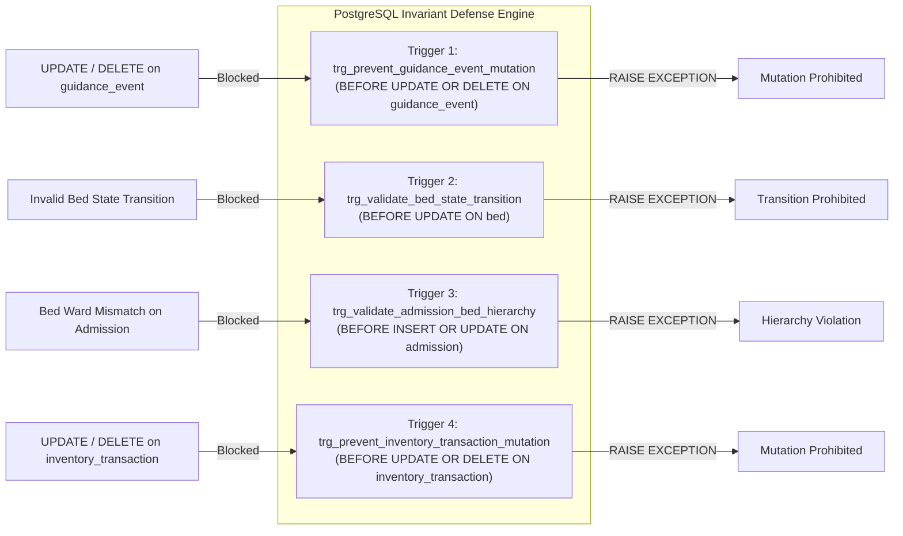
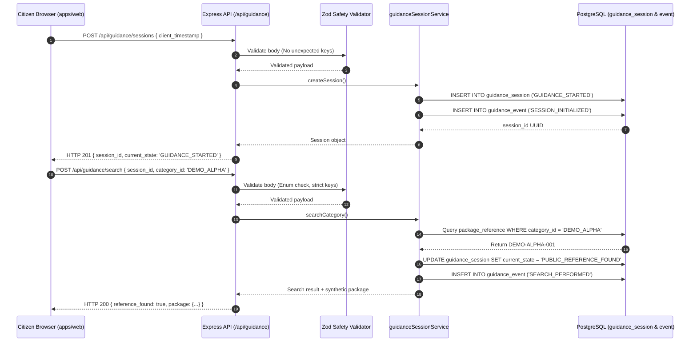
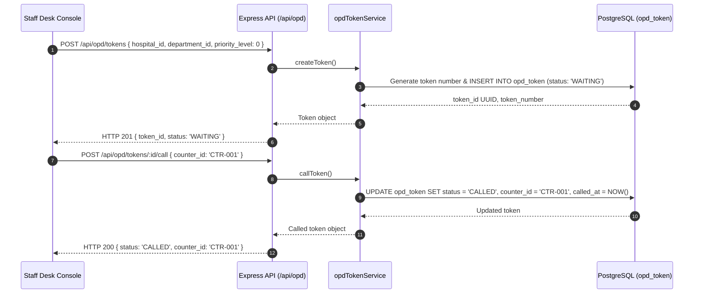

# End-to-End System Architecture

> **Document Path**: `docs/architecture/system-architecture.md`  
> **Status**: Architecture Freeze v2.1  
> **System**: Healthcare Access Guidance & Operations Platform

---

## 1. System Architectural Overview

The **Healthcare Access Guidance & Operations Platform** implements a hardened, multi-tier decoupled architecture designed for high integrity, privacy protection, and operational clarity. The architecture spans six distinct architectural tiers:

```
+--------------------------------------------------------------------------------------------------------+
| TIER 1: PRESENTATION LAYER (apps/web)                                                                 |
| React 18 + Vite SPA | Tailwind CSS | AppShell Navigation | Citizen Flow | Staff Operations Console    |
+--------------------------------------------------------------------------------------------------------+
                                                    | HTTP / REST (JSON)
                                                    v
+--------------------------------------------------------------------------------------------------------+
| TIER 2: API GATEWAY & APPLICATION SERVER (apps/api)                                                   |
| Express 4.19 | Helmet Security Headers | CORS | Morgan Request Logging | Canonical Route Dispatcher     |
+--------------------------------------------------------------------------------------------------------+
                                                    |
                                                    v
+--------------------------------------------------------------------------------------------------------+
| TIER 3: VALIDATION & AUTHORIZATION BOUNDARY                                                            |
| Strict Zod Unknown-Key Rejection | Param/Query Sanitization | requireAdmin Bearer Auth Middleware       |
+--------------------------------------------------------------------------------------------------------+
                                                    |
                                                    v
+--------------------------------------------------------------------------------------------------------+
| TIER 4: SERVICE & STATE MACHINE ORCHESTRATION LAYER                                                    |
| Guidance Session Engine | OPD Queue Dispatcher | Bed Coordinator | Inpatient Manager | M/M/c Engine   |
+--------------------------------------------------------------------------------------------------------+
                                                    | Parameterized SQL (pg.Pool)
                                                    v
+--------------------------------------------------------------------------------------------------------+
| TIER 5: PERSISTENCE & STORAGE ENGINE (PostgreSQL 14+)                                                  |
| 17 Relational Tables | Composite Foreign Keys | 4 PL/pgSQL Immutability & Transition Triggers          |
+--------------------------------------------------------------------------------------------------------+
                                                    ^
                                                    | Periodic Batch Extraction & Upsert (psycopg2)
+--------------------------------------------------------------------------------------------------------+
| TIER 6: OFFLINE BATCH DATA ENGINEERING & CITY SNAPSHOT PIPELINE (etl/)                                 |
| transform_events.py (Daily Telemetry Rollup) | aggregate_city_snapshot.py (Hierarchical City Snapshot)|
+--------------------------------------------------------------------------------------------------------+
```

---

## 2. Detailed Multi-Tier Architectural Breakdown

### 2.1 Tier 1: Presentation Layer (`apps/web`)

The frontend is a single-page application built with **React 18.3.1**, compiled and served by **Vite 5.3.3**, and styled with **Tailwind CSS 3.4.4**.

#### Navigation & Layout Architecture (`AppShell.jsx`)
- **State-Driven View Controller**: The entire application is orchestrated via state-driven tab switching in `App.jsx` using `currentView`:
  - `DASHBOARD`: Facility overview, quick KPI counters, rapid navigation actions.
  - `OPD_QUEUE`: Outpatient Department token management, counter assignments, and queue status filtering.
  - `BEDS`: Real-time ward bed matrix, bed state transitions, and occupancy counters.
  - `ADMISSIONS`: Inpatient admission pipeline, review processing, and bed allocations.
  - `INVENTORY`: Synthetic dispensary stock monitoring, threshold alerts, and transaction history.
  - `ANALYTICS`: Operational wait-time analysis and Kendall M/M/c theoretical queuing benchmarks.
  - `CITY_OVERVIEW`: Municipal multi-facility aggregate dashboard based on `city_aggregate_snapshot`.
  - `CITIZEN_GUIDANCE`: Privacy-preserving public guidance workflow (`CitizenGuidanceWrapper.jsx`).
  - `GUIDANCE_ADMIN`: Administrative audit ledger and telemetry inspector (`AdminAnalyticsPage.jsx`).
- **Facility Selector**: Header-level dropdown allowing staff operators to seamlessly toggle between synthetic hospitals (`HOSP-001: Metro Civic Hospital`, `HOSP-002: Suburban Community Health Center`).
- **Connection Health Polling**: Automatic background ping to `/api/health` updating a persistent system status badge (`HEALTHY`, `CONNECTING`, `OFFLINE`).

#### Two Distinct Operating Modes
1. **Citizen Guidance Workflow**:
   - Zero patient data intake. Users navigate purely through controlled categorical options (`DEMO_ALPHA`, `DEMO_BETA`, `DEMO_GAMMA`, `NO_MATCH_DEMO`).
   - Steps: `LandingPage` &rarr; `CategorySelectionPage` &rarr; `ReferenceFoundPage` / `ReferenceNotFoundPage` &rarr; `OfficialRoutePage` &rarr; `CompletionPage`.
   - Displays clear disclaimer banners that results are synthetic demonstration records.
2. **Staff Operations Console**:
   - High-density administrative workspace for facility personnel.
   - Real-time modal forms for token creation, counter calls, bed transitions, and stock additions.
   - Comprehensive status badges reflecting underlying database enum values.

---

### 2.2 Tier 2: API Gateway & Application Server (`apps/api`)

The backend is built with **Node.js 18+** and **Express 4.19.2** in `apps/api/src/app.js` and `apps/api/src/server.js`.

#### Global Middleware Stack
1. **Helmet 8.3.0**: Enforces HTTP security headers (`X-Content-Type-Options: nosniff`, `X-Frame-Options: DENY`, `Strict-Transport-Security`).
2. **CORS 2.8.5**: Controls cross-origin browser requests between the Vite development server (port 5173) and the Express API (port 5001).
3. **Morgan 1.12.1**: Logs HTTP request method, path, response status, and latency.
4. **Express JSON Body Parser**: Parses inbound JSON payloads up to 1MB.

#### Canonical REST Route Tree
Mounted under `/api` in `apps/api/src/routes/index.js`:

```
/api
├── /health                               [GET]   System health check
├── /categories                           [GET]   Controlled category registry
├── /guidance
│   ├── /sessions                         [POST]  Initialize anonymous guidance session
│   ├── /search                           [POST]  Controlled category search
│   ├── /official-route                   [POST]  Transition to official route card
│   ├── /support-route                    [POST]  Transition to support route card
│   ├── /complete                         [POST]  Finalize session (GUIDANCE_COMPLETED)
│   └── /sessions/:id                     [GET]   Fetch session state and audit events
├── /reference-packages                   [GET]   List synthetic demonstration packages
├── /official-support-routes              [GET]   Fetch statutory verification route cards
├── /admin/analytics
│   ├── /summary                          [GET]   Non-PII session telemetry KPIs (requireAdmin)
│   └── /data-quality                     [GET]   Data quality issue audit ledger (requireAdmin)
├── /hospitals                            [GET]   List synthetic hospitals
│   └── /:hospitalId/departments          [GET]   List departments for hospital
├── /opd
│   ├── /analytics                        [GET]   Queue telemetry & M/M/c analytical benchmarks
│   ├── /tokens                           [GET]   List OPD queue tokens
│   ├── /tokens                           [POST]  Create anonymous OPD queue token
│   ├── /tokens/:tokenId/call             [POST]  Call token to counter (WAITING -> CALLED)
│   ├── /tokens/:tokenId/start            [POST]  Start service (CALLED -> IN_SERVICE)
│   ├── /tokens/:tokenId/complete         [POST]  Complete service (IN_SERVICE -> COMPLETED)
│   └── /tokens/:tokenId/cancel           [POST]  Cancel token (-> CANCELLED)
├── /beds
│   ├── /:bedId/reserve                   [POST]  Reserve bed (AVAILABLE -> RESERVED)
│   ├── /:bedId/occupy                    [POST]  Occupy bed (RESERVED -> OCCUPIED)
│   ├── /:bedId/clean                     [POST]  Send for cleaning (OCCUPIED -> CLEANING)
│   ├── /:bedId/release                   [POST]  Release to service (CLEANING -> AVAILABLE)
│   ├── /:bedId/out-of-service            [POST]  Mark maintenance (AVAILABLE -> OUT_OF_SERVICE)
│   └── /:bedId/restore                   [POST]  Restore from maintenance (-> AVAILABLE)
├── /admissions
│   ├── /                                 [GET]   List inpatient admissions
│   ├── /                                 [POST]  Create admission request
│   ├── /:admissionId                     [GET]   Get admission details
│   ├── /:admissionId/pending-review      [POST]  Move to PENDING_REVIEW
│   ├── /:admissionId/assign-bed          [POST]  Assign bed to admission
│   ├── /:admissionId/confirm             [POST]  Confirm admission
│   ├── /:admissionId/admit               [POST]  Mark patient admitted
│   ├── /:admissionId/discharge           [POST]  Discharge patient
│   └── /:admissionId/cancel              [POST]  Cancel admission
└── /inventory
    ├── /items                            [GET]   List synthetic inventory items
    ├── /items/:itemId                    [GET]   Get inventory item details
    ├── /availability                     [GET]   List low-stock items / alerts
    ├── /transactions                     [GET]   List inventory transactions
    ├── /items/:itemId/transactions       [GET]   List transactions for specific item
    ├── /items/:itemId/receive            [POST]  Record stock receipt (RECEIPT)
    ├── /items/:itemId/issue              [POST]  Record stock issue (ISSUE)
    ├── /items/:itemId/adjust             [POST]  Record stock adjustment (ADJUSTMENT)
    ├── /items/:itemId/transfer-in        [POST]  Record stock transfer in (TRANSFER_IN)
    └── /items/:itemId/transfer-out       [POST]  Record stock transfer out (TRANSFER_OUT)
```

---

### 2.3 Tier 3: Validation & Authorization Boundaries

The platform implements strict structural security checks before requests reach business logic services:

```
[ Inbound HTTP Request ]
       |
       v
[ Safety Validator Middleware (validateBody / validateParams / validateQuery) ]
  ├── Evaluates request against strict Zod Schema (.strict())
  ├── Unknown Keys Detected? ──────────────> REJECT: HTTP 400 Bad Request
  ├── Regex / Type Violations? ────────────> REJECT: HTTP 400 Bad Request
  └── Payload Validated & Sanitized
       |
       v
[ Authorization Boundary (requireAdmin for /api/admin/*) ]
  ├── ALLOW_UNAUTHENTICATED_ADMIN_DEMO === 'true'? ──> BYPASS (Local Demo Only)
  ├── Missing Authorization Header? ───────> REJECT: HTTP 401 Unauthorized
  ├── Invalid Token (!== 'demo-admin-token')? ───> REJECT: HTTP 403 Forbidden
  └── Token Verified
       |
       v
[ Target Business Service ]
```

#### Strict Zod Validation Schemas
- Implemented in `apps/api/src/validators/`:
  - `sessionValidators.js`: Enforces UUID format for `session_id`, restrict categories to enum (`DEMO_ALPHA`, `DEMO_BETA`, `DEMO_GAMMA`, `NO_MATCH_DEMO`), unknown-key rejection.
  - `opdValidators.js`: Rejects unexpected parameters, validates priority levels, enforces counter assignment schemas.
  - `bedValidators.js`: Validates UUID/string bed identifiers.
  - `admissionValidators.js`: Validates ward, bed, and token links.
  - `inventoryValidators.js`: Enforces positive integer quantities and valid transaction types.

#### Admin Authorization Boundary (`requireAdmin.js`)
- Enforces Bearer token authentication on `/api/admin/*`.
- Developer safety guard: `ALLOW_UNAUTHENTICATED_ADMIN_DEMO=true` permits unauthenticated access **solely** for local developer evaluation and single-machine academic grading. It is prohibited in any multi-user or production environment.

---

### 2.4 Tier 4: Business Logic & State Machine Orchestration

Business logic is encapsulated in isolated services in `apps/api/src/services/`:

1. **`guidanceSessionService.js`**:
   - Manages the 7-state guidance state machine.
   - Enforces legal state transitions (`GUIDANCE_STARTED` &rarr; `SERVICE_SEARCHED`, etc.). Out-of-order transitions throw HTTP 409 `INVALID_STATE_TRANSITION`.
   - Logs state changes to `guidance_event` inside database transactions.
2. **`opdTokenService.js`**:
   - Generates sequential token numbers (e.g., `TKN-GEN-001`, `TKN-PED-002`).
   - Tracks queue timestamps (`issued_at`, `called_at`, `service_started_at`, `service_completed_at`).
   - Computes live department queue summaries (waiting, serving, completed counts).
3. **`bedService.js`**:
   - Executes bed state transitions. Relies on database trigger `trg_validate_bed_state_transition` as the authoritative invariant validator.
4. **`admissionService.js`**:
   - Manages inpatient admissions from request to discharge.
   - Allocates beds, ensuring that trigger `trg_validate_admission_bed_hierarchy` confirms facility and ward consistency.
5. **`inventoryService.js`**:
   - Updates stock levels in `inventory_item` and logs immutable records into `inventory_transaction`.
   - Computes low-stock alerts based on `reorder_threshold`.
6. **`opdAnalyticsService.js` & `mmc.js`**:
   - Calculates empirical queue metrics (average wait time, average service duration).
   - Solves Kendall's M/M/c multiserver queueing model via Erlang-C formula:
     $$\rho = \frac{\lambda}{c \cdot \mu}, \quad P_0 = \left[ \sum_{k=0}^{c-1} \frac{(c\rho)^k}{k!} + \frac{(c\rho)^c}{c!(1-\rho)} \right]^{-1}, \quad P_{wait} = \frac{(c\rho)^c}{c!(1-\rho)} P_0$$
     $$L_q = \frac{\rho \cdot P_{wait}}{1 - \rho}, \quad W_q = \frac{L_q}{\lambda}$$

---

### 2.5 Tier 5: Persistence & Storage Engine (`PostgreSQL 14+`)

The platform connects to PostgreSQL via a configured connection pool (`apps/api/src/db/index.js`). The 17-table schema provides the foundation for data integrity.

#### Four PL/pgSQL Invariant Triggers



1. **`prevent_guidance_event_mutation()`**: Raises an exception on any `UPDATE` or `DELETE` targeting `guidance_event`, guaranteeing append-only immutability.
2. **`validate_bed_state_transition()`**: Verifies that new bed states follow allowed transition paths (`AVAILABLE` &rarr; `RESERVED`/`OUT_OF_SERVICE`, `RESERVED` &rarr; `OCCUPIED`/`AVAILABLE`, `OCCUPIED` &rarr; `CLEANING`, `CLEANING` &rarr; `AVAILABLE`, `OUT_OF_SERVICE` &rarr; `AVAILABLE`).
3. **`validate_admission_bed_hierarchy()`**: When `bed_id` is assigned to an admission, queries `bed` and asserts `hospital_id` and `ward_id` exactly match the admission.
4. **`prevent_inventory_transaction_mutation()`**: Blocks `UPDATE` and `DELETE` on `inventory_transaction`, creating an immutable ledger.

---

### 2.6 Tier 6: Offline Batch Data Engineering & City Snapshot Pipeline (`etl/`)

The data engineering tier consists of decoupled Python scripts executed as scheduled cron jobs or on-demand batch processes.

#### 1. Daily Telemetry Aggregator (`etl/transform_events.py`)
- **Extract**: Queries `guidance_session`, `guidance_event`, and `data_quality_issue` via `psycopg2`.
- **Transform**: Uses `pandas` to group sessions by date, calculate completion rate percentages, and aggregate event type distribution dictionaries.
- **Load**: Performs an idempotent upsert into `analytics_summary` using `ON CONFLICT (metric_date) DO UPDATE`.

#### 2. Hierarchical Municipal Snapshot Engine (`etl/aggregate_city_snapshot.py`)

```mermaid
sequenceDiagram
    autonumber
    participant CRON as Scheduled ETL Runner
    participant PY as aggregate_city_snapshot.py
    participant DB_READ as PostgreSQL (Operational Tables)
    participant DB_WRITE as city_aggregate_snapshot (Table #17)

    CRON->>PY: Execute ETL (Hourly / Daily Batch)
    PY->>DB_READ: Extract OPD tokens, Counters, Beds, Admissions, Inventory
    DB_READ-->>PY: Return raw DataFrames (RealDictCursor)
    
    rect rgb(30, 41, 59)
        Note over PY: Compute Hierarchical Rollups
        PY->>PY: 1. DEPARTMENT Level: Queue volume, active counters, wait/service times
        PY->>PY: 2. HOSPITAL Level: Bed occupancy rates, ICU capacity, admissions pipeline, low-stock counts
        PY->>PY: 3. CITY Level: Municipal aggregation across all facilities in the urban district
    end

    PY->>DB_WRITE: Batch upsert snapshots using uq_city_snap_slot arbiter index
    DB_WRITE-->>PY: Confirmation (Insert / Update counts)
    PY->>CRON: Execution Summary Log (is_simulated = TRUE)
```



- **Three Aggregation Levels**:
  - `DEPARTMENT`: Granular operational queue metrics per department.
  - `HOSPITAL`: Facility-wide operational overview including total beds, ICU beds, occupancy rates, admissions, and low-stock inventory counts.
  - `CITY`: Regional municipal aggregation combining metrics across all monitored hospitals.
- **Idempotent Upsert Arbiter**:
  - Targets the unique composite index `uq_city_snap_slot` on `(snapshot_timestamp, snapshot_period, aggregate_level, hospital_id, department_id)`.
  - Guarantees that re-running batch jobs does not generate duplicate records or corrupt historical trends.
- **Data Governance**:
  - Automatically flags all records with `is_simulated = TRUE`.
  - Attaches standard confidence notice: `"Simulated periodic operational snapshot. Does not represent live municipal availability."`

---

## 3. End-to-End Request & Data Flow Sequences

### 3.1 Public Citizen Guidance Request Flow



### 3.2 Staff OPD Token Issuance & Queue Flow



---

## 4. Architectural Boundaries: Implemented vs. Planned

| Architectural Dimension | Implemented in Current System (Stage 1 / v2.1) | Planned / Future Evolution |
| :--- | :--- | :--- |
| **Client Application** | React 18 single-page app with view-switching AppShell, responsive Tailwind CSS layouts, and live health status indicator. | Dedicated mobile app (React Native / Flutter), progressive web app (PWA) offline caching. |
| **API Architecture** | Express 4 REST API with strict Zod validation, parameter checking, and unified route tree. | GraphQL / gRPC interfaces for high-throughput inter-service communication. |
| **Authentication & RBAC** | `requireAdmin` Bearer token boundary on `/api/admin/*`, `requireStaff` authorization on operational state mutations, production bypass prohibition (`NODE_ENV=production`), and in-memory IP rate limiting (`X-RateLimit-*`). | OAuth2 / OIDC enterprise identity provider (Keycloak / Auth0), granular role-based permissions per department. |
| **Persistence Engine** | PostgreSQL 14+ with 17 relational tables, composite foreign keys, and 4 PL/pgSQL triggers. | Read replicas for analytics, database table partitioning by month for `guidance_event` and `city_aggregate_snapshot`. |
| **ETL & Telemetry** | Python batch pipelines (`transform_events.py`, `aggregate_city_snapshot.py`) with idempotent upserts. | Distributed workflow orchestration via Apache Airflow, real-time message streaming via Apache Kafka. |
| **External Integration** | Explicitly isolated. Uses synthetic reference catalogues and simulated facilities. | HL7 FHIR interfaces for hospital Electronic Health Records (EHR), statutory verification gateway adapters. |
